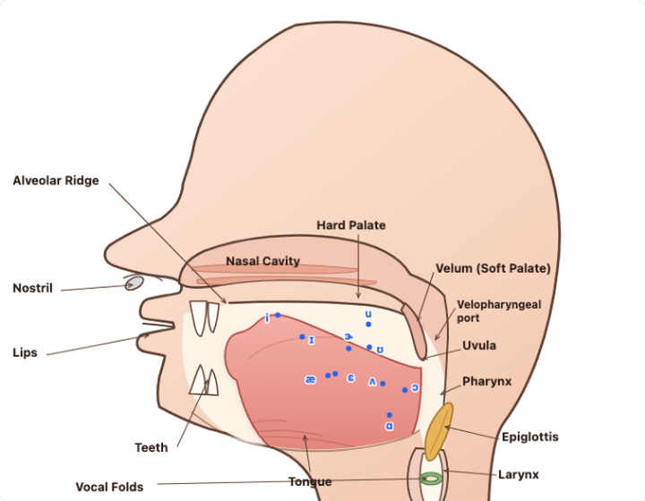

# Vowel Formant Tracker

A real-time vowel formant (F1/F2) tracker for English pronunciation practice. It estimates
your formants from the microphone and draws a moving midsagittal **tongue** against
native-speaker vowel targets.



## What it does

1. Shows a **clean warm sagittal cutaway** focused on the oral cavity — peach skin/tissue,
   a pale cream mouth cavity, a coral muscular tongue, a soft-pink nasal cavity with turbinate
   folds, ivory teeth, and warm velum/larynx accents. Labeled structures include the nostril,
   lips, teeth, alveolar ridge, hard palate, nasal cavity, velum, uvula, nasopharynx /
   velopharyngeal port, tongue, pharynx, epiglottis (gold leaf at the larynx) and larynx.
   The oral cavity is drawn tall and the tongue rests on its floor. Reference vowels are drawn
   as blue (men) or violet (women) dots with IPA labels at their target tongue positions.
2. Records your microphone and estimates F1/F2 continuously with **Linear Predictive Coding**
   (autocorrelation method + Levinson–Durbin) and **pole-based formant extraction**
   (Durand–Kerner root solver).
3. Draws your live tongue as a high-contrast coral shape. The drawn position is lightly
   stabilised — implausible formants and one-frame spikes are rejected, and it uses the median
   of the last three accepted frames — so the tongue does not twitch on a single bad estimate.
   Every 0.5–3 s (default 1.5 s) it also prints a small dot at the median F1/F2 of your recent
   voiced frames, so you can see how consistent you are.
4. Shows live F1/F2, the nearest reference vowel, and the approximate distance in Hz —
   <120 Hz is close, <260 Hz is noticeable, above that is far.
5. Shows the fundamental frequency (**F0**) and animates the **vocal folds** in the larynx:
   they open and close while you are voiced and rest apart when you are silent. Voicing is
   decided by **periodicity** (YIN) with a noise check, not by loudness — so /s/, /t/ and loud
   aperiodic noise do not animate the folds.
6. Can replay the last 3 seconds of your voice.

## How to run

Microphone access requires a **secure context** (https or `localhost`). Serve the folder with
any static server and open it in Chrome, Firefox, or Safari:

```bash
cd vowel-formant-tracker
python3 -m http.server 8000
# then open http://localhost:8000
```

Or, if you have `npx`:

```bash
npx serve .
```

## Usage

1. Click **Start microphone** and allow access.
2. Choose **Men** or **Women** as your reference (default: Men).
3. Sustain one vowel at a time (e.g. /i/ "ee", /ɑ/ "ah", /u/ "oo").
4. The **rose tongue** shows your live tongue position; aim it at the target dot of the vowel
   you are practising. The trail dots show your recent attempts — a tight cluster means you
   are consistent.
5. The readout tells you the nearest reference vowel and how far away you are.
6. Hit **▶ Play back** to hear the last 3 seconds of your voice.
7. Switch between **Tongue**, **F1×F2 Bark**, and **F1×F2 Hz** to see the same data as a
   classic vowel chart.

## Camera (optional)

Click **◉ Camera** to let the front camera drive the jaw. The face appears as a small
picture-in-picture panel on the diagram, with the lip contour overlaid, and the lower jaw,
lower teeth, mouth floor, tongue underside and lower lip follow your jaw opening. The
jaw percentage is shown in the read-out.

The video is processed on-device and is never uploaded. The camera needs a secure context
(`localhost` or https) and internet: the MediaPipe face model is fetched from a CDN the first
time. If it cannot start, the audio-only view keeps working. The separate `lip-lab.html`
probe offers the fuller lip measurements (rounding, spreading, protrusion, jaw) with CSV
export.

## Reading the diagram

- The head is a **cutaway** (the near side of the face is removed), so the oral cavity and
  tongue are visible even with the lips closed.
- The nasal cavity continues behind the velum into the pharynx through the **velopharyngeal
  port**. It is drawn open (velum lowered) so the route is visible; for oral vowels the velum
  closes it. This app trains oral vowels and does not measure nasality.
- The mouth is deliberately cropped into focus and its cavity is left pale/cream (rather than
  red) so the coral tongue is the clearest thing on the plate. The teeth and neck are drawn
  small; the tongue movement is the priority.
- **Vertical** = tongue height, from F1 in Bark: high/close vowels at the top, low/open vowels
  at the bottom.
- **Horizontal** = front/back, from F2−F1 in Bark: front vowels at the left, back vowels at
  the right.
- The target dots/labels are **mean** values, not ranges. Real productions vary; use the
  distance readout and the consistency of your trail as the guide.

## Reference data

Hillenbrand, J., Getty, L. A., Clark, M. J., & Wheeler, K. (1995). Acoustic characteristics
of American English vowels. *Journal of the Acoustical Society of America, 97*(5),
3099–3111. Means for men (n=45) and women (n=48), /hVd/ context.

The drawing is a schematic for teaching, not a medical illustration.

## Experimental: camera probe

`lip-lab.html` is a separate probe (not part of the app) for camera-based lip and jaw
tracking. It uses MediaPipe Face Landmarker to measure lip aperture, rounding, spreading,
protrusion and jaw, with a neutral baseline and CSV export. Serve the same folder and open
`/lip-lab.html`; it needs `localhost`/https for the camera and internet for the model.

## Sharing it

The app is **static** — no backend, no build step. Any HTTPS static host works:

- **Netlify Drop** (easiest): drag this folder (or `vowel-formant-tracker-deploy.zip`) onto
  <https://app.netlify.com/drop>. You get a `https://….netlify.app` URL in seconds.
- **GitHub Pages**: put `index.html` (and optionally `lip-lab.html`) at the root of a repo,
  then Settings → Pages → Deploy from branch → `main` / root.
- **Cloudflare Pages**: direct upload of the same folder/zip; gives `https://….pages.dev`.
- **Temporary live demo from your machine**: `cloudflared tunnel --url http://localhost:8000`
  (no account for quick tunnels). Your machine must stay awake; the URL dies when you stop it.

Why not just send the HTML file or use a LAN IP? Browsers only allow `getUserMedia` in a
**secure context**: `https://` or `localhost`. Opening `index.html` as `file://…` or
`http://192.168.x.x:8000` will render the page but the microphone and camera will be blocked.

The camera mode fetches the MediaPipe model from a CDN; if a colleague's network blocks
jsDelivr/Google Storage, the audio-only app still works.
